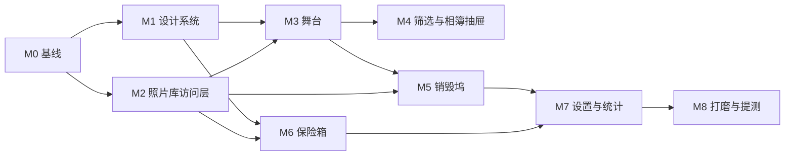

# SuperPhotos 开发计划（一期 MVP）

> v0.2 · 2026-11-08
> 关联：[产品方案](./product-plan.md)｜[决策记录](./open-questions.md)
> 执行方式：按 M0 → M9 顺序推进，每个里程碑完成后先汇报（附验证证据），确认后再进入下一个。
> 已定：iOS 17.6 / iPhone+iPad / 自适应 Compact·Regular / VIP 权益层一期先做 / 保险箱免费仅图片。

---

## 1. 技术基线

| 项 | 结论 | 说明 |
| --- | --- | --- |
| UI | SwiftUI 为主，局部 UIKit | 舞台分页器与缩放用 UIKit 包一层（`UIViewRepresentable`），其余全 SwiftUI |
| 语言/并发 | Swift 6 + Swift Concurrency | 服务层用 `actor`，UI 状态 `@Observable` + `@MainActor` |
| 最低系统 | **iOS 17.6** | target 已是 17.6；项目级 `27.0` 在 M0 对齐，避免配置漂移 |
| 设备 | **iPhone + iPad**（`1,2`），竖屏/横屏自适应 | Compact（Duo 外屏/iPhone）与 Regular（Duo 内屏/iPad）两套容器，同一份视图 |
| 持久化 | SwiftData（清单/统计）+ Keychain（凭据）+ 文件系统（保险箱文件） | 设置项用 `@AppStorage` |
| 第三方依赖 | **无** | 需要的能力均由系统框架提供 |
| 系统框架 | Photos、PhotosUI、SwiftUI、UIKit、Security、AVFoundation、CoreHaptics、SwiftData、Foundation | 二期增加 StoreKit；一期无 CryptoKit 内容加密 |

### 工程现状（M0 处理）

| 问题 | 现状 | 处理 |
| --- | --- | --- |
| 项目级部署目标漂移 | 项目级 `27.0`，target 已是 `17.6` | 项目级统一改为 `17.6`；清理 `XROS_*` / `TVOS_*` 等无关配置 |
| 设备族 | 已是 `1,2`（正确） | 保留；不引入 visionOS |
| Bundle ID | 已是 `com.gpwzw.appSuperPhotos`（正确） | 保留 |
| 模板调试代码 | [ContentView.swift](../source/appSuperPhotos/SuperPhotos/ContentView.swift) 里 `import Playgrounds` 与 `#Playground` | 删除（会阻断归档/上架构建） |
| 入口命名 | [SuperPhotos.swift](../source/appSuperPhotos/SuperPhotos/SuperPhotos.swift) 中 `@main struct MyApp` | 改为 `SuperPhotosApp`，接入 App 状态容器 |
| 权限文案 | 未配置 | 用 `INFOPLIST_KEY_NSPhotoLibraryUsageDescription` / `NSPhotoLibraryAddUsageDescription` 写入 |
| 资源 | 无 AppIcon / 启动屏 / 声音资源 | 补占位图标与 3 个音效占位（M9 前定稿） |

---

## 2. 目录与模块划分

```
SuperPhotos/
├─ App/
│  ├─ SuperPhotosApp.swift          // @main，注入环境
│  ├─ AppModel.swift                // 全局 @Observable 状态（唯一真源）
│  └─ ScenePhaseGuard.swift         // 后台锁、隐私遮罩
├─ Core/
│  ├─ Entitlements/
│  │  ├─ Entitlement.swift           // tier / 来源 / 快照
│  │  ├─ Feature.swift               // 能力枚举与最低档位
│  │  ├─ EntitlementStore.swift      // 唯一判定入口 + 模拟开关持久化
│  │  └─ VaultLimits.swift           // 容量 / 媒体类型 / 批量上限门禁
│  ├─ DesignSystem/
│  │  ├─ Theme.swift                // 明/暗 token
│  │  ├─ NeuSurface.swift           // raised / inset / pressed
│  │  ├─ NeuButton.swift
│  │  ├─ Typography.swift
│  │  └─ Motion.swift
│  ├─ Feedback/
│  │  ├─ Haptics.swift              // CoreHaptics + 降级
│  │  └─ SoundPlayer.swift          // ambient 会话、播放器池
│  ├─ Persistence/
│  │  ├─ ModelContainer.swift       // SwiftData schema
│  │  ├─ KeychainStore.swift
│  │  └─ Paths.swift                // Application Support 相对路径
│  └─ Support/                      // 日志、格式化、去抖
├─ PhotoLibrary/
│  ├─ AuthorizationService.swift
│  ├─ LibraryService.swift          // 唯一查询入口（含排除规则）
│  ├─ FetchQueryBuilder.swift
│  ├─ AssetRef.swift                // PhotoItem
│  ├─ ThumbnailLoader.swift
│  ├─ DeleteService.swift
│  └─ ChangeObserver.swift
├─ Vault/
│  ├─ VaultCredentials.swift        // PBKDF2 + Keychain
│  ├─ VaultCrypto.swift             // AES-GCM
│  ├─ VaultStore.swift              // actor：文件读写、占用、清单
│  ├─ VaultImporter.swift           // 入库（资源复制 + isHidden）
│  ├─ VaultRestorer.swift           // 取出 / 导出 / 重建资产
│  └─ VaultLockPolicy.swift         // 错误计数与锁定
├─ Features/
│  ├─ Home/
│  │  ├─ HomeView.swift
│  │  ├─ HeaderBar.swift
│  │  ├─ EdgeRail.swift
│  │  ├─ Stage/PhotoStageView.swift     // UIKit 分页 + 缩放
│  │  └─ SelectionToolbar.swift
│  ├─ Filters/
│  │  ├─ FilterBar.swift
│  │  ├─ TypeChipPopover.swift
│  │  └─ AlbumsDrawer.swift
│  ├─ Destroy/
│  │  ├─ DestroyDock.swift
│  │  ├─ MachineSelector.swift
│  │  ├─ FireplaceMachine.swift
│  │  ├─ ShredderMachine.swift
│  │  └─ DestroyCoordinator.swift
│  ├─ Vault/
│  │  ├─ VaultPreviewDrawer.swift
│  │  ├─ VaultLockView.swift
│  │  ├─ DialView.swift
│  │  ├─ VaultRoomView.swift
│  │  └─ VaultItemDetail.swift
│  ├─ Settings/
│  │  ├─ SettingsView.swift
│  │  ├─ DisplayModeSection.swift
│  │  ├─ StatsView.swift
│  │  ├─ VIPView.swift
│  │  └─ VaultSecurityView.swift
│  └─ Onboarding/
└─ Resources/
   ├─ Assets.xcassets
   ├─ Sounds/ (fire_loop.caf, shred_start.caf, shred_loop.caf)
   ├─ PrivacyInfo.xcprivacy
   └─ Localizable.xcstrings (zh-Hans)
```

依赖关系：



---

## 3. 数据模型草案

> 仅示意结构，M0/M1 定稿后再落地为 Swift 类型。

```swift
// 运行时（不持久化 PHAsset）
struct PhotoItem: Identifiable, Hashable {
    let id: String            // PHAsset.localIdentifier
    let kind: MediaKind
    let pixelSize: CGSize
    let duration: TimeInterval
    let createdAt: Date?
    let isCloudOnly: Bool
    let isHidden: Bool
    let albumIDs: [String]
}

// SwiftData：保险箱清单
@Model final class VaultRecord {
    @Attribute(.unique) var id: UUID
    var originLocalID: String?       // 入库时系统资产 id，可能已失效
    var fileName: String             // 原始文件名
    var mediaKindRaw: String
    var byteSize: Int64
    var capturedAt: Date?
    var addedAt: Date
    var albumNames: [String]
    var relativePath: String         // 相对 Application Support，切勿存绝对路径
    var pairedVideoPath: String?     // Live Photo 的成对视频
    var stateRaw: String             // active / restoring / broken
}

@Model final class DestroyEvent {
    var id: UUID
    var machineRaw: String
    var assetIDs: [String]
    var bytesKnown: Int64            // 未知大小资产不计入
    var at: Date
}

@Model final class DailyStat {
    var day: Date                    // 当天 00:00
    var viewed: Int
    var destroyedFireplace: Int
    var destroyedShredder: Int
    var vaultIn: Int
    var vaultOut: Int
    var freedBytesKnown: Int64
}
```

要点：
- 沙盒容器路径在重装/迁移后会变，**所有文件路径只存相对路径**。
- 清单只存"业务需要"的最小元数据，不复制 EXIF（EXIF 在文件里）。
- 统计用"事件 + 日汇总"双写：事件用于原始追溯，日汇总用于展示，重置时一并清空。

---

## 4. 关键实现方案

### 4.1 VIP 权益层（一期优先，内购二期）

```swift
enum EntitlementTier: String, Codable { case free, vip }
enum EntitlementSource: Equatable { case mock, storeKit, promotional }
struct EntitlementSnapshot: Equatable {
    var tier: EntitlementTier
    var source: EntitlementSource
    var isMock: Bool
}

enum Feature: CaseIterable {
    case vaultAllMediaTypes     // 实况照片 / 视频
    case vaultUnlimitedCapacity // 不限 60 件 / 2GB
    case statsAdvanced          // 趋势图 / 分布 / 报告
    case extraMachines          // 二期更多销毁玩法
    case batchLimit100          // 批量 100（免费 50）
    case dialSkins              // 密码盘皮肤 / 音效包
}

enum GateResult: Equatable {
    case allowed
    case requiresVIP(String)    // 给 UI 的提示文案
    case quotaExceeded(String)
}
```

- `EntitlementStore` 是唯一判定入口：`@Observable`、`@MainActor`，持有 `EntitlementSnapshot`。
- 来源抽象：一期 `MockEntitlementProvider`（持久化 `mockTier` 到 UserDefaults，key `entitlement.mockTier`）；二期换成 `StoreKitEntitlementProvider`（Transaction.currentEntitlements），**门禁调用点不变**。
- 门禁 API：
  - `func isEnabled(_ feature: Feature) -> Bool`
  - `func canImport(kind: MediaKind) -> GateResult`
  - `func quotaStatus(usedItems: Int, usedBytes: Int64) -> GateResult`
  - `func batchLimit(for tier:) -> Int`
- 免费仅静态图片：`photo / screenshot / panorama / animated` 视为图片；`livePhoto / video` 拒绝并给 `requiresVIP` 文案。
- 免费容量 60 件 / 2GB；VIP 不限。判定用"当前清单条数 + 待入库条数"与"已用字节 + 待入库字节"。
- 调用点必须集中在 `VaultImporter`、`DestroyCoordinator`、`StatsView`、`SettingsView` 四处，页面里不许出现 `if tier == .vip` 的散落判断。
- 设置页 VIP 分组提供"模拟 VIP"开关（标注"模拟，仅测试"），切换后所有门禁立即生效并跨启动保持。

### 4.2 权限与访问层

```swift
// 伪接口
protocol LibraryServing {
    func requestAccess() async -> AccessState
    func fetchItems(_ filter: LibraryFilter) async throws -> [PhotoItem]
    func requestThumbnail(for id: String, size: CGSize) -> AsyncStream<UIImage>
    func delete(assetIDs: [String]) async throws
    func setHidden(_ hidden: Bool, assetIDs: [String]) async throws
}
```

- 授权：`PHPhotoLibrary.requestAuthorization(for: .readWrite)`；`.limited` 时通过 `presentLimitedLibraryPicker` 管理范围，并设 `preventAutomaticLimitedAccessAlert = true`。
- 查询：`PHFetchOptions` 按 `creationDate` 倒序 + `predicate` 缩小媒体类型范围；`isHidden` 与保险箱 id 集合在 `LibraryService` 内存中排除（单点入口，界面不得自行 fetch）。
- 缩略图：`PHCachingImageManager` 预热前后各 3 张，目标尺寸 = 舞台宽 × 2，`resizeMode = .fast`、`deliveryMode = .highQualityFormat`。
- 变更：`PHPhotoLibraryChangeObserver` → 300ms 去抖 → 重取并发出 `libraryDidChange` 事件。

### 4.3 舞台（分页 + 缩放）

- 用 `UICollectionView`（横向、`isPagingEnabled`、cell 宽 = 舞台宽 - 24、间距 12）承载分页；每个 cell 内放一个 `UIScrollView` + `UIImageView` 负责缩放。
- 缩放开始时回调 `onZoomChanged(true)`，外层把 `collectionView.isScrollEnabled = false`；缩放回 1.0 再恢复。
- 双击缩放：`UITapGestureRecognizer` 两下，中心点为双击点，动画 240ms。
- 拖拽拾起：长按 `UILongPressGestureRecognizer`（350ms）+ 命中测试；拾起后由 SwiftUI 拖拽层接管（`DragGesture` 坐标系为窗口级），拖到坞/左轨的命中区用几何判断。
- 预取：`collectionView(_:prefetchItemsAt:)` 触发 `PHCachingImageManager.startCachingImages`。
- 失败兜底：若 UIKit 方案在真机上仍出现翻页与缩放互斥问题，退化为"每页独立 `UIScrollView` + 手动分页（`UIPageViewController`）"；不再回退到纯 SwiftUI `ScrollView`。

### 4.4 抽屉与手势仲裁

- `ActivePanel` 枚举作为唯一真源；抽屉用 `offset` + `DragGesture` 跟手（见产品方案 6.1）。
- 轨道命中区 24pt 用透明 `Color.clear.contentShape(Rectangle())` 实现，压在舞台之上。
- 舞台手势与抽屉手势不同层，靠"起点区域"自然隔离；同层冲突用 `simultaneousGesture` + 轴判定（`abs(dx) > abs(dy) * 1.2` 才认横向）。
- 抽屉内滚动用 `ScrollView`，横向手势不注册，避免与舞台"抢"。
- 测试要点：从屏幕最左 20pt 起手、从极少见的对角滑动、双指同时滑动，都不能出现"翻页 + 开抽屉"同时发生。

### 4.5 销毁协调器

```swift
@MainActor
final class DestroyCoordinator {
    private(set) var phase: DestroyPhase
    private(set) var tickets: [DestroyTicket]

    func enqueue(_ ids: [String], machine: MachineKind)
    func beginCharge() async throws
    func cancel()                    // 蓄力期可取消
    func commit() async throws       // 只调用一次 performChanges
}
```

时序（严格串行，避免重入）：

1. `armed` → 等待 200ms 吸附。
2. `charging` 1.2s，期间 `Task` 可被取消（取消即 `ejecting`）。
3. `commit()`：先重取资产校验存在性 → `performChanges` 整批删除 → 系统弹窗。
4. 成功 → `destroying` 播动画 → 写 `DestroyEvent` + `DailyStat` → `finished`。
5. 取消/失败 → `ejecting` → 清空或保留队列（保留供重试）。

实现要点：
- **幂等**：用 `isCommitting` 标记，系统弹窗期间禁止再次提交。
- `performChanges` 的 completion 可能不在主线程 → 显式 `await MainActor.run`。
- 用户取消时 `error` 通常是 `NSError`（`PHPhotosError` 域），不要当成崩溃处理。

### 4.6 机器动效

| 内容 | 方案 |
| --- | --- |
| 炉膛暖光 | `RadialGradient` + `TimelineView(.animation)` 驱动透明度与位移 |
| 火星粒子 | 12–20 个 `Circle` + 随机相位，`Canvas` 绘制；低电量减半 |
| 燃烧腐蚀 | 照片快照 + 位移噪声遮罩（预生成噪声 `CGImage`），用 `mask` 逐帧推进 |
| 碎纸切片 | `CGImage.cropping(to:)` 后台切 14 列，主线程只做位置动画 |
| 刀口金属 | 三段线性渐变 + 12° 旋转，加 1pt 高光描边 |
| 减弱动效 | 直接切到"200ms 淡出 + 数字 +n"分支，代码路径独立便于回归 |

性能红线：SE3 真机 55fps 以上；批量 50 张总时长 ≤ 2.4s；动画期间内存增量 < 40MB。

### 4.7 密码盘

- 旋转输入：`DragGesture` 取相对盘心的 `atan2` 角度，累加并解缠绕（跨 0/360 不跳变）。
- 档位换算：A 盘 `step = 2π/13`，B 盘 `step = 2π/37`；吸附阈值 40%，其余回弹。
- 触感：每次档位变化触发 `UISelectionFeedbackGenerator.selectionChanged()`；快速旋转时限流到 30ms 一次。
- 自动校验：两个盘都停止变化 600ms 后触发一次校验（用 `Task.sleep` + 版本号防抖）。
- VoiceOver：`accessibilityAdjustableAction`，上下轻扫 ±1 档，值朗读"左盘 7，右盘 23"。
- 视觉：数字用 `Text` + 内阴影；旋转用 `rotationEffect`，高光方向固定（不随盘旋转，保持光源一致）。

### 4.8 凭据与文件保护

```swift
// 伪接口
enum VaultCredentials {
    static func setPassword(a: Int, b: Int) throws
    static func verify(a: Int, b: Int) throws -> Bool   // 常数时间比较
    static func changePassword(old: (Int, Int), new: (Int, Int)) throws
    static func resetAll() throws
}
```

- PBKDF2-SHA256，120,000 次迭代，盐 32B 随机；`CommonCrypto.CCKeyDerivationPBKDF`。
- Keychain：`kSecClassGenericPassword`，service 前缀 `dev.superphotos.vault`，`kSecAttrAccessibleWhenUnlockedThisDeviceOnly`，`kSecAttrSynchronizable = false`。
- 文件保护：写入时给 URL 设置 `.completeFileProtection`（`FileProtectionType`），并设 `isExcludedFromBackup = true`；一期不做 App 层内容加密（决策 Q5=A）。
- 锁定状态机：`failures` / `lockUntil` 存 Keychain；每次校验前先读状态，倒计时用 `Timer` 只做展示。
- 所有密码相关日志禁用（自定义 `Logger` 的 privacy 标注为 `.private`）。

### 4.9 保险箱 IO

入库（决策 B：复制 + 删除原件）：

1. **门禁**：`EntitlementStore.canImport(kind:)` 与 `quotaStatus` 先行；免费拒绝 `livePhoto / video`，容量按 60 件 / 2GB 判定。
2. `PHAssetResource.assetResources(for:)` 取原始资源；静态图片取 `.photo`（或 `.fullSizePhoto`），VIP 的 Live Photo 再取 `.pairedVideo`，视频取 `.fullSizeVideo` / `.video`。
3. 预检可用空间（`URLResourceValues.volumeAvailableCapacityForImportantUsage`）。
4. `PHAssetResourceManager.writeData(for:toFile:options:)`，`isNetworkAccessAllowed = true`，`progressHandler` 回主线程更新进度；写入 Application Support/Vault 下相对路径。
5. 设置 `.completeFileProtection` 与 `isExcludedFromBackup`，写 `VaultRecord`（含 `originLocalID`）。
6. `performChanges` 删除原件（系统确认，最后一步）；成功 → 完成；失败/取消 → 保留副本，记录 `pendingRemoval = true`，提供"重试移出相簿"。
7. 复制阶段失败 → 删半成品文件与清单，不动原件。

取出（原件已删除，必须重建）：

1. `PHAssetCreationRequest.forAsset()` + `addResource(with:fileURL:options:)` + `creationDate = capturedAt`；VIP 的 Live Photo 同时加 `.pairedVideo`；视频用对应 resource type。
2. 保留原文件名（`PHAssetResourceCreationOptions.originalFilename`）。
3. 成功后按 `albumNames` 匹配现有相簿并加入；相簿不存在则留在"最近项目"并提示。
4. 重建成功后删除沙盒副本与清单；失败保留并提示重试。

导出：`ShareLink`（单张）与系统"存储到文件"（批量），只导出原图，不导出清单。

### 4.10 统计写入

- 销毁成功：`DestroyEvent` + `DailyStat.destroyedXxx += n`，同一事务。
- 浏览：舞台停留 ≥ 0.5s 且资产 id 当日未记过 → `viewed += 1`（内存去重集合，按天滚动）。
- 入库/取出：操作成功后 +1。
- 空间：删除前取资源字节数（`requestImageDataAndOrientation` 的 `data.count` 或资源写入后文件大小）；iCloud 未下载则记为"未知"，展示加 `≈`。
- 汇总读取：按月/年聚合用 `FetchDescriptor` + 内存聚合，20k 库量级无需索引优化。

---

## 5. 性能与资源预算

| 指标 | 目标 | 验证方式 |
| --- | --- | --- |
| 冷启动到可交互 | < 1.2s（iPhone 12 起） | Instruments App Launch |
| 首屏照片出现 | < 600ms（20k 库） | 真机计时 |
| 翻页 | 稳定 60fps，无白屏 | Instruments Core Animation |
| 内存峰值 | < 200MB（20k 库 + 翻页 60 次） | Instruments Allocations |
| 筛选切换 | < 300ms | 真机计时 |
| 销毁动画 | SE3 ≥ 55fps | 真机录屏 + 帧率日志 |
| 保险箱解锁 | < 300ms（验证 + 开门动画起播） | 真机计时 |
| 入库 1 张 12MP | < 1.5s（本地） | 真机计时 |

降级策略：低电量模式关闭粒子；内存警告时清空缩略图缓存；iCloud-only 资产默认只显示占位。

---

## 6. 合规与上架清单

| 项 | 内容 |
| --- | --- |
| Info.plist | `NSPhotoLibraryUsageDescription`："SuperPhotos 需要访问你的相簿，以便浏览、整理照片，并把照片存入保险箱。"<br>`NSPhotoLibraryAddUsageDescription`："用于把保险箱中的照片恢复到相簿。"<br>（二期）`NSFaceIDUsageDescription` |
| 隐私清单 | `PrivacyInfo.xcprivacy`：`NSPrivacyTracking = false`；不采集数据；必需理由 API：UserDefaults（CA92.1）、文件时间戳（C617.1）、磁盘空间（E174.1） |
| 数据流 | 一期零网络请求；无第三方 SDK；无广告标识符 |
| 审核风险 | 不得宣称"从手机彻底隐藏/无法恢复"；保险箱说明需写明"内容存于 App 内，卸载即删除"；删除需说明进入系统"最近删除" |
| 内购（二期） | StoreKit 2；提供恢复购买、管理订阅链接；价格与权益在 App 内可见；遵守 3.1.2 |
| 音效/字体 | 只使用原创或已授权素材，关于页列出许可 |
| 本地化 | 一期 zh-Hans；`Localizable.xcstrings` 用 key 化，二期直接加 en |

---

## 7. 分期计划与验收标准

### Phase 0：基线（M0）

| 内容 | 完成标准 |
| --- | --- |
| 工程配置修正（项目级部署目标 17.6、清理无关平台配置、移除 Playgrounds、入口改名、权限文案、显示名） | Debug 构建通过；Release 归档通过；无模板残留 |
| 建立目录骨架、`AppModel`、`Theme` 空实现、SwiftData 容器、启动占位首页 | 模拟器可启动；SwiftData schema v1 |

### Phase 1：MVP（M1–M9）

按顺序推进，**每个里程碑结束提交一次汇报**。

#### M1 VIP 权益层（优先）

- 交付：`EntitlementTier` / 来源 / 快照、`Feature` 映射、`EntitlementStore`（模拟来源 + 持久化）、`VaultLimits`（媒体类型 / 容量 / 批量）、设置页"模拟 VIP"开关（先用系统 List 呈现）。
- 验收：免费时实况/视频被拦截并给出升级文案；60 件 / 2GB 边界判定正确（59/60/61、1.9/2.0/2.1GB）；VIP 全放开；切换即时生效且重启保持；门禁调用点仅 4 处；无价格与购买文案。

#### M2 设计系统

- 交付：明/暗两套 token、`NeuSurface`（raised/inset/pressed）、`NeuButton`、字号/圆角/动效 token、组件预览页。
- 验收：Preview 可一键切明暗；21 个关键控件对比度达标（明 ≥ 10:1 主文、暗 ≥ 4.5:1）；Dynamic Type AX3 不截断；Reduce Motion 生效；所有可点区 ≥ 44pt。

#### M3 照片库访问层

- 交付：授权四态、`LibraryService`（唯一查询入口，含排除规则）、缩略图加载与预热、变更观察、删除写入。
- 验收：20k 模拟库首屏 < 600ms；筛选 < 300ms；`.limited` 提示条与管理入口可用；`.denied` 围栏页可达设置；外部增删 1s 内反映；删除只弹一次系统确认。

#### M4 舞台

- 交付：UIKit 分页器 + 缩放、页码、信息条、长按多选、拖拽拾起、预取、随宽度自适应。
- 验收：翻页 60fps 无白屏；1–5× 缩放正常，放大态不翻页；双击缩放；切筛选重置缩放与页码；拖拽出舞台时翻页禁用；内存 < 200MB；320pt 与 700pt 宽度下均可用。

#### M5 筛选与相簿抽屉

- 交付：类型 chips（6 类）、相簿 chip、右侧抽屉/Regular 右列（智能相簿 + 我的相簿 + 数量）、空态。
- 验收：类型映射与系统相簿一致（固定样本集逐类核对）；相簿数量正确；空相簿不展示；选择后舞台回到第 1 张；抽屉/列与舞台手势零冲突。

#### M6 销毁坞

- 交付：坞折叠/展开、机器切换、壁炉与碎纸机动画、队列托盘、协调器、退件、批量、音效与触感、Reduce Motion 分支。
- 验收：单张与批量都只触发一次系统确认；取消后 UI 回到 armed 且数据零变化；SE3 动画 ≥ 55fps；批量 50 张 ≤ 2.4s；Toast 文案含"最近删除 30 天"；统计事件正确写入。

#### M7 保险箱

- 交付：预览抽屉/Regular 左列、密码盘锁屏、锁定策略、Keychain 凭据、`.completeFileProtection`、入库（复制 + 删除原件）、取出（重建）、导出/永久删除、隐私遮罩、免费媒体类型门禁。
- 验收：0–12 / 0–36 全档位可达且吸附准确；错误 5 次锁 60s，杀进程不重置；正确解锁到开门 < 300ms；**免费账号入库实况/视频被拒且提示清晰**；VIP 入库 Live Photo 双资源完整；入库后原件从相簿消失（最近删除可见）；取出重建后创建时间与相簿归属正确；App 被杀后清单与文件一致；重置彻底清空；后台切回必锁且多任务快照无内容。

#### M8 设置与统计

- 交付：显示模式、高对比度、降低动效、音效开关、统计页与重置、VIP 权益页（由 `EntitlementStore` 驱动）、密码管理、关于与隐私。
- 验收：显示模式即时生效且重启保持；统计在 3 组固定样本上与手工计数一致；修改密码需旧密码；重置保险箱有双重确认；VIP 页随模拟开关即时变化且无价格/购买按钮。

#### M9 打磨与提测

- 交付：首次引导、空态/异常态、无障碍、**Compact / Regular 双形态回归**（320 / 375 / 430pt 与 700 / 834 / 1024pt）、真机矩阵、TestFlight 构建。
- 验收：20 人内测无阻断性缺陷；崩溃率 0；VoiceOver 可完成"浏览 → 销毁 → 入库 → 取出"全流程；iOS 17.6 与最新系统各一台真机通过；折叠/展开切换不丢当前照片与筛选；Release 归档无警告。

### Phase 2：商业化与玩法扩展

| 模块 | 依赖 | 完成标准 |
| --- | --- | --- |
| StoreKit 2 订阅（替换 Mock 权益来源）+ 恢复购买 | M1 / M8 | 沙盒购买、恢复、跨设备权益一致；无购买按钮的降级路径正确；门禁调用点零改动 |
| 新销毁玩法（如熔炉/液压机/酸池） | M6 | 复用协调器，仅新增动画与音效；每种玩法有独立的"策略"对象 |
| 统计趋势图与年度报告分享图 | M8 | 图表在明暗两套下可读；分享图不含隐私元数据 |
| Face ID 解锁（密码为最终凭据） | M7 | 生物识别失败 3 次自动回落到密码盘 |
| 入库方式切换（彻底移出相簿 / 系统隐藏） | M7 | 切换后新入库按新模式执行，旧记录不受影响 |
| 相簿整理（移动到相簿/收藏） | M3 | 与删除共用权限与变更观察 |

### Phase 3：规模化

| 模块 | 说明 |
| --- | --- |
| 折叠形态深度适配 | 铰链/悬停/多窗口/姿态变化（一期只做尺寸自适应） |
| 智能建议 | 截图、重复、模糊、大视频分组（本地分析，不上传） |
| Share Extension / Widget / Shortcuts | 快速入库、快速销毁入口 |
| 保险箱跨设备 | CloudKit + 端到端加密（密钥不出设备） |
| 多语言与主题皮肤 | en 优先，皮肤走资源包 |

---

## 8. 测试计划

**单元测试（必做）**
- 权益：免费/VIP × 媒体类型（6 类）、容量（59/60/61、1.9/2.0/2.1GB）、批量上限（50/100）；模拟开关持久化与恢复。
- 筛选映射：6 种类型 × 相簿范围的组合。
- 密码盘：角度 → 档位换算的边界（0/12/36、跨 360°、反向旋转）。
- 凭据：PBKDF2 验证值稳定性、常数时间比较、错误计数与锁定时间推进。
- 保险箱清单：写入/读取/重建/删除后的一致性；相对路径在容器变更后仍可用；`pendingRemoval` 重试。
- 统计：事件 → 日汇总 → 月聚合；"未知大小"不计入总量。

**UI/集成测试**
- 五区冒烟：授权 → 筛选 → 翻页 → 销毁 → 入库 → 解锁 → 取出。
- 权益冒烟：免费拦截实况/视频 → 切模拟 VIP → 同一张入库成功。
- 手势矩阵（产品方案 6.2 的 15 条逐条验证）。
- 明/暗/高对比度/Dynamic Type XXXL 的截图快照。
- Compact 320/375/430pt 与 Regular 700/834/1024pt 的布局快照；折叠/展开切换保留状态。
- 系统删除取消、系统删除成功、iCloud 未下载、磁盘不足四条异常路径。

**真机矩阵**
- iPhone SE3（小屏 + 无 120Hz）、iPhone 15（主流）、iPhone 16 Pro（大屏 + 高刷）。
- iPad 一台（Regular 布局）；如可获取 Duo 设备/模拟器，加测外屏与内屏。
- iOS 17.6 与最新正式版各一台。

---

## 9. 风险登记

| # | 风险 | 影响 | 对策 |
| --- | --- | --- | --- |
| 1 | 新拟物对比度不足，审核无障碍不过 | 高 | token 化 + 高对比开关 + Accessibility Inspector 逐项过 |
| 2 | 舞台翻页/缩放/拖拽互斥失败 | 高 | UIKit 分页器兜底方案，M4 先做手势专项验证 |
| 3 | 五区信息密度过高，新用户迷失 | 中 | 折叠坞 + 首次引导 + 抽屉互斥 + 首次 3 次手势提示 |
| 4 | 每次删除都弹系统确认，打断心流 | 中 | 批量合并为一次；蓄力阶段提前显示数量 |
| 5 | 密码盘组合仅 481 种 | 中 | 阶梯锁定 + 随机组合生成 + 文案诚实 + 二期 Face ID |
| 6 | 保险箱副本导致双倍存储 | 中 | 免费容量上限 + 入库预检 + 占用可视化 |
| 7 | iCloud-only 资源入库慢/失败 | 中 | 进度 + 允许网络 + 失败回滚 + 跳过此张 |
| 8 | 动画在低端机型掉帧 | 中 | 预切片、粒子降级、低电量模式分支 |
| 9 | 权益判定散落在各页面，二期接内购时返工 | 中 | 门禁集中在 `EntitlementStore` 的 4 个调用点，页面禁止直接判断 tier |
| 10 | "隐藏照片"宣称引发审核质疑 | 中 | 文案改为"存入 App 保险箱"，设置页如实说明能力边界 |
| 11 | 音效素材版权 | 低 | 先用占位音，正式版替换并列入许可 |
| 12 | 折叠形态切换导致布局/状态跳变 | 中 | 断点容器 + 状态与视图分离；M9 做 320–1024pt 快照回归 |
