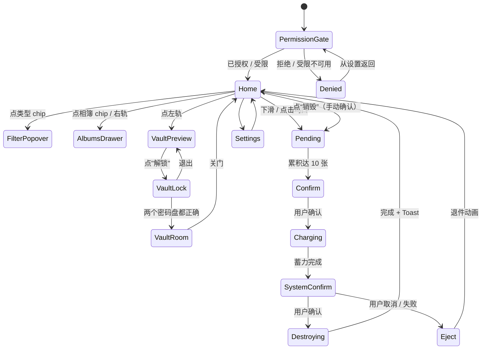

# SuperPhotos 产品方案

> v0.2 · 已确认 · 2026-11-08
> 关联文档：[开发计划](./development-plan.md)｜[决策记录](./open-questions.md)
> 状态：用户已拍板（见 open-questions.md 决策记录），据此开发；每个里程碑完成后先汇报再继续。

---

## 1. 定位与设计原则

**一句话定位**：SuperPhotos 是一台"有实体"的相册整理机——把删照片从枯燥的列表操作，变成把照片丢进壁炉或碎纸机的仪式；把不想被别人随手翻到的照片，放进一台需要转对两个密码盘才会开门的保险箱。

要解决的三个问题：

| 痛点 | 现状 | SuperPhotos 的做法 |
| --- | --- | --- |
| 相簿越攒越多，清理动作枯燥、拖延 | 系统相簿一张张勾选、点删除，零反馈 | 五区一屏流式浏览 + 拟物销毁的仪式感与即时反馈 |
| 不知道从哪开始整理 | 没有"当前一张"的焦点 | 中间用堆叠把"当前一张 + 后面三张"同时呈现，处理完自然进入下一张 |
| 私密照片无处安放 | 系统"隐藏相簿"路径深、容易被发现 | 独立保险箱：双密码盘 + 沙盒副本 + 系统隐藏 |

五条设计原则（后续所有设计争议按此裁决）：

1. **舞台优先**：任何时刻，屏幕中央那张照片是唯一主角；其他四区都是"工具"，不得同时抢占焦点。
2. **手感先于效率**：每个处理动作必须有材质、光影、声音、触感四层反馈；宁可多一步操作，也不做无反馈的静默处理。
3. **危险动作两段式**：蓄力 → 系统确认 → 销毁，永不一步到位；任何取消路径都要有"退件"动画，而不是无声消失。
4. **私密要诚实**：明确告诉用户照片去了哪里、能不能找回。不做"从手机彻底消失"这类做不到的承诺。
5. **一屏五区，只有一区是"活的"**：同一时刻只有一个区域接收手势，靠区域所有权而不是手势优先级来避免冲突。

**非目标（明确不做）**：不做云相册、不做图片编辑器、不做社交、不做"AI 自动评分清理"（三期再议）、不替用户静默删除、不接入第三方统计 SDK。

---

## 2. 用户与场景

| 用户 | 特征 | 核心诉求 |
| --- | --- | --- |
| 主力：相簿臃肿者 | 相簿 1–3 万张，存储告急，想清理但一直拖 | 低门槛、有快感地一张张清掉 |
| 次主力：需要藏照片的人 | 家庭共用设备、工作素材、私人影像 | 快速入库、别人翻相簿看不到 |
| 顺带用户：整理爱好者 | 喜欢"收拾"这件事本身 | 玩法、动效、统计成就感 |

典型场景：睡前躺着清 3 分钟；旅行回来批量筛废片；把证件照/截图收进保险箱；换机前把不想带走的照片销毁。

一期不做账号体系，所有数据本地存储，**App 不发起任何网络请求**（二期上架订阅时才引入 StoreKit 网络）。

---

## 3. 核心闭环与信息架构

### 3.1 核心闭环

```
筛选（顶部类型/相簿） → 浏览判定（中间舞台） → 处理（底部销毁 / 左侧入库） → 反馈（动效+统计） → 下一张
```

### 3.2 页面地图

```
启动
├─ 权限预热页（首次）
│   ├─ 已授权 / 受限 → 主界面
│   └─ 拒绝 → 权限围栏页（去设置 / 重试）
├─ 首次引导（3 页：五区说明 / 销毁玩法 / 保险箱，可跳过）
└─ 主界面 Home
    ├─ 顶部筛选区：类型 chips + 相簿 chip（点相簿 chip = 打开右侧抽屉）
    ├─ 左侧 20%：保险箱实体列（只露箱门，左滑存入时开门、照片飞入）
    ├─ 中间 60%：拍立得堆叠舞台，轻点下一张 / 捏合缩放 / 下滑入待销毁
    ├─ 右侧 20%：收藏夹列（上下滚动选择默认相簿，右滑存入时打开、照片飞入）
    ├─ 顶部相簿 chip → 相簿抽屉（智能相簿 + 我的相簿，仅改筛选范围）
    ├─ 底部：销毁坞（壁炉 / 碎纸机）
    ├─ 左上：保险箱入口（= 打开锁屏）
    ├─ 右上：设置
    └─ 浮层：照片信息浮层、待销毁确认弹窗、Toast
设置
├─ 显示模式（明 / 暗 / 跟随系统）+ 高对比度 + 降低动效
├─ 统计（今日 / 本周 / 本月 / 累计 + 重置）
├─ VIP（一期只做权益说明，无购买入口）
├─ 私密保险箱（修改密码 / 重置 / 自动锁定 / 入库方式）
└─ 关于与隐私（版本、隐私说明、音效许可、清空统计）
```

### 3.3 导航原则

- **不叠两层模态**：抽屉打开时不能再开抽屉；锁屏打开时关闭所有抽屉。
- **单一出口**：每一层都有明确的关闭方式（点遮罩 / 下滑 / 左滑 / 返回按钮），不做只能靠手势的页面。
- **安全区优先**：任何可点击元素距屏幕边缘 ≥ 12pt，避免与系统边缘手势、Home indicator 冲突。
- **状态可恢复**：来电、切后台、权限变更、外部删照片后，回到前台必须回到一致状态（见 5.3）。

---

## 4. 主界面五区布局

### 4.1 布局基准

以 iPhone 16 逻辑尺寸 393 × 852（安全区上 59 / 下 34）为基准，所有数值按比例适配到 SE3（375 × 667）与小屏时优先压缩舞台高度，不压缩点击区。

```
393 × 852
┌──────────────────────────────────────────────┐ y=59
│ (◎) 保险箱     [全部▾] [相机胶卷 ▾]      (⚙) │  Header 56
├──────────────────────────────────────────────┤ y=115
│ 类型 chips / 相簿 chip                        │  FilterBar 44
├──────────────────────────────────────────────┤
│ 全部照片                          1,204 / 20k │  StageHeader 40
├────────────┬──────────────────┬──────────────┤
│            │                  │              │
│  20% 保险箱 │  60% 拍立得堆叠   │ 20% 收藏夹   │
│  实体门     │  0° / -15° / +10° │ 相簿列表     │
│  (门可开)   │  / -5° 错落       │ (竖向滚动)   │
│            │                  │              │
│            │  信息条 / 提示     │              │
├────────────┴──────────────────┴──────────────┤ y≈620
│  ▁▁▁▁▁▁▁▁  炉膛 / 刀口（内凹）               │
│  [ 壁炉 ]  [ 碎纸机 ]      ← 横滑切换         │ DestroyDock
│  待销毁进度条 ███░░░░  3 / 10    [销毁]      │  折叠 132 / 展开 208
└──────────────────────────────────────────────┘ y=852
```

> 左右两列是**常驻实体**（不是覆盖抽屉），三列在 320–1024pt 全宽度范围都成立；抽屉只保留“筛选相簿”一种，从顶部相簿 chip 打开。

### 4.2 尺寸规格

| 区域 | 尺寸 | 说明 |
| --- | --- | --- |
| Header | 高 56，左右内边距 16 | 左：保险箱按钮 44×44；中：类型 chip 高 32 + 相簿 chip 高 32，横向可滚；右：设置 44×44 |
| 舞台卡片 | 拍立得相纸：宽高比 3:4，左右边距 9、上 9、下 24，圆角 6 | 照片按原比例 `scaledToFit` 缩进相纸，多出的部分即白/黑边距；边距颜色跟随主题（亮=暖白、暗=近黑） |
| 左列（保险箱） | 宽度 `min(148, max(64, 可用宽 × 0.2))`，门占满列高，圆角 11 | 只露箱门：黄铜面板 + 转盘 + 件数；点按打开预览抽屉 |
| 右列（收藏夹） | 同左列宽度 | 竖向滚动列出全部“我的相簿”，选中项黄铜描边高亮 |
| 抽屉 | 宽 `min(0.78 × 屏宽, 320)`，从右侧滑出 | 只用于筛选相簿；遮罩透明度 0.28，舞台缩放至 0.96 并禁用交互 |
| 销毁坞 | 折叠 132 / 展开 208，左右内边距 16，底部距 Home indicator 12 | 上边缘有 8pt 与舞台的分隔内凹槽 |
| 机器选择条 | 高 48 | 只有这一条响应"横滑切换机器"；坞体其余区域不响应横滑 |

### 4.3 五区共存的四条规则

1. **抽屉互斥**：`ActivePanel` 是一个枚举（`.none / .vaultPreview / .albums / .filterPopover`），任意时刻只有一个非 nil。
2. **舞台让位**：抽屉打开时舞台不重排（避免照片跳动），只做 0.96 缩放 + 0.28 遮罩 + 手势禁用；抽屉关闭后恢复。
3. **机器可折叠**：坞默认 132，进入待销毁累积 / 蓄力时展开到 208；退出后 200ms 内回收，避免长期占用舞台。
4. **角标独立**：左上保险箱、右上设置是浮在 Header 上的圆形按钮，不参与五区布局，永远可点（除锁屏态）。

### 4.4 各区域交互响应

| 区域 | 默认态 | 展开/激活态 | 关闭方式 |
| --- | --- | --- | --- |
| 顶部类型 | 显示当前类型 chip，点开 popover 选择（全部/照片/视频/实况/截图/全景/动图） | 选中后立即重取数据，舞台回到第 1 张 | 点空白 / 再次点 chip |
| 顶部相簿 | 显示当前范围（全部照片/最近/收藏/某个相簿） | 点开右侧相簿抽屉（仅改筛选范围） | 点遮罩 / 左滑收回 |
| 左侧保险箱 | 常驻实体门 + 件数徽标 | 左滑照片时门打开、照片飞入；点门打开预览抽屉 | 遮罩 / 门自动合上 |
| 右侧收藏夹 | 常驻相簿列，当前默认收藏夹高亮 | 上下滑动切换默认收藏夹；右滑照片时选中卡片脉冲、照片飞入 | 无（常驻） |
| 底部销毁坞 | 两种机器的入口，当前机器高亮 | 下滑加入后展开，口部点亮，进度条显示 `n / 10` | 清空累积 / 取消蓄力 / 完成后自动回收 |
| 舞台 | 4 张拍立得错落叠放 + 页码 `1,204 / 20,318` | 轻点下一张、下滑入待销毁、左滑入保险箱、右滑入收藏夹、捏合缩放 | 各手势反向操作 / 完成按钮 |

### 4.5 自适应布局（iPhone Duo 外屏 / 内屏 / iPad）

以"可用宽度 + 水平 size class"决定容器，**一套视图、两种容器**，不做两套页面。

| 形态 | 典型宽度 | 布局 |
| --- | --- | --- |
| Duo 外屏 / iPhone 竖屏（Compact） | 320–430pt | 三列常驻；两侧收窄到 64–86pt，箱门与收藏夹用更小的立式缩略，中间舞台拿走剩余宽度 |
| Duo 内屏 / iPad 横屏（Regular） | 600–1024pt | 三列常驻：两侧按 `20%` 放宽（上限 148），中间舞台自适应；坞横跨整行 |
| iPad 竖屏（Regular） | 768pt | 同三列，两侧 148 封顶、中间更宽 |

规则：

- 三列宽度只由一个公式决定：`side = min(148, max(64, availableWidth * 0.2))`，中间列吃满剩余；不再按 600pt 断点切换两套布局。
- 同一份 `AppModel`、同一份视图，不为 Compact / Regular 复制页面实现。
- 相簿筛选改为顶部 chip 打开右侧抽屉；抽屉打开时舞台缩放 0.96 并禁用交互。
- **折叠/展开（尺寸变化）**：保留当前照片 id、筛选条件、坞状态、收藏夹选中项与列滚动位置；不重新请求、不重置到第 1 张。
- 舞台卡片最大宽 640pt 居中；坞最大宽 640pt 居中；两侧留白随宽度增加。
- 内屏折叠铰链：使用安全区 + 中间 8pt 视觉分隔，不把可点元素放在铰链缝上。
- 安全区与 Home indicator 规则不变（见 4.2、6.1）。

---

## 5. 状态与流转

### 5.1 主界面状态机



舞台内部的子状态：`idle(scale=1)` → `paging` / `zoomed(1<scale≤4)` / `discarding`。下滑入待销毁与翻页、缩放互斥，同一时刻只归属一种手势。

### 5.2 关键状态数据

```swift
enum ActivePanel { case none, vaultPreview, albums, filterPopover }
enum StageInteraction { case idle, paging, zoomed, discarding }
enum DestroyPhase { case idle, armed, charging, awaitingSystemConfirm, destroying, ejecting, finished }
/// 待销毁累积达到该值自动触发确认；集中为常量方便调整。
enum DestroyPolicy { static let autoConfirmThreshold = 10 }
```

### 5.3 打断与恢复

| 事件 | 处理 |
| --- | --- |
| 切后台（`scenePhase == .background`） | 保险箱立即上锁；销毁蓄力状态取消并退件；锁屏/保险箱内容盖一张关门图，防止 App 切换器快照泄露 |
| 来电 / 控制中心（`.inactive`） | 不做数据变更；仅覆盖隐私遮罩 |
| 照片在系统相簿被删 | `PHPhotoLibraryChangeObserver` 收到变更，300ms 去抖后重取；当前照片若消失则前进到相邻位置，不跳回第 1 张 |
| 权限被系统回收 | 回到权限围栏页，保留已有统计与保险箱数据 |
| 蓄力过程中 App 被杀 | 不产生任何删除；重启后 `DestroyPhase = .idle`，队列清空（队列是易失的，见 7.3） |
| 系统确认弹窗期间切后台 | 以 `performChanges` 的 completion 结果为准；成功后仍播放销毁动画（允许后台返回后补播） |

---

## 6. 手势与冲突仲裁

### 6.1 仲裁原则

- **P1 区域所有权**：手势结果只由起点所在区域决定，不做跨区模糊识别。
- **P2 舞台内按状态让位**：1× 缩放时，轻点 = 下一张，左滑 = 存入保险箱，右滑 = 存入收藏夹，下滑 = 加入待销毁；放大后所有拖动 = 平移；捏合永远属于缩放。
- **P3 抽屉互斥且吞手势**：抽屉展开时，抽屉内所有手势不再冒泡到舞台。
- **P4 系统手势避让**：屏幕左右各 20pt、底部 34pt 归系统；两侧实体列的点按区距边缘 ≥ 12pt，销毁坞底部再留 12pt。
- **P5 方向裁决**：舞台拖动在起点后 4pt 内按主方向归类——纵向向下归“加入待销毁”，向左归“存入保险箱”，向右归“存入收藏夹”；一旦归类不中途改判，横向不再有翻页语义。

### 6.2 冲突矩阵

| # | 手势 | 起点 | 结果 | 明确不触发 |
| --- | --- | --- | --- | --- |
| 1 | 轻点 | 舞台当前卡片 | 当前照片放大到 120% 后向上飞出，下面一张升为当前 | 不加入待销毁、不翻页 |
| 2 | 横滑 | 舞台（1×） | 左滑 ≥64pt = 照片飞入保险箱（箱门同开），随后弹“复制 + 移出原件”确认；右滑 ≥64pt = 加入默认收藏夹并自动下一张；跟手位移不足则回弹 | 不翻页、不切机器、不直接删除 |
| 3 | 下滑 | 舞台当前卡片 | 位移超过 96pt（或甩动预测超过 172pt）→ 飞入底部处理口 + 粒子消除，加入待销毁累积 | 不直接删除系统照片 |
| 4 | 下滑不足阈值 | 舞台当前卡片 | 弹性回弹到原位，不改变任何状态 | 不加入累积 |
| 5 | 捏合 | 舞台 | 1–4× 缩放；低于 1.06× 时回到 1× | 不翻页、不进待销毁 |
| 6 | 拖动（放大态） | 舞台 | 平移图片，到边界后橡皮筋 | 不翻页、不加入待销毁 |
| 7 | 竖向滚动 | 右列收藏夹 | 在“我的相簿”列表里滚动；点一行设为默认收藏夹并持久化 | 不影响舞台 |
| 8 | 横滑 | 机器选择条（高 48） | 壁炉 ⇄ 碎纸机，跟手 + 弹性吸附 | 不翻页（起点不在舞台） |
| 9 | 横滑 | 抽屉内部 | 抽屉内部手势（保险箱行左滑出"更多"） | 舞台不翻页 |
| 10 | 竖滑 | 抽屉列表 | 列表滚动 | — |
| 11 | 点击炉口/刀口 | 坞 | 无障碍路径：让当前照片执行一次等效下滑，加入待销毁 | 不直接删除 |
| 12 | 点击“销毁” | 坞 | 弹出确认弹窗；确认后才走批量系统删除 | 不立即删除 |
| 13 | 累积达 10 张 | 坞 | 自动点亮销毁指示灯并弹出确认弹窗 | 未确认不删除 |
| 14 | 竖滑（抽屉已开） | 遮罩 | 关闭抽屉 | — |
| 15 | 取消 / 清空 | 坞 | 累积退回舞台，照片重新可见 | 不删除 |

### 6.3 堆叠舞台的具体规则

- 一次展示 4 张拍立得相纸：最上层 0°，第二张左转 15°，第三张右转 10°，第四张左转 5°；配合每层 `(-7,+11) / (+9,+17) / (-13,+23)` 偏移与 0.985 / 0.97 / 0.955 缩放，形成随手一叠的错落感，不做机械阶梯。
- 相纸尺寸按可用区域等比适配（宽高比 3:4）：左右边距 9、上 9、下 24（拍立得下颚）；照片按自身比例 `scaledToFit` 缩进相纸，未填满的部分即白色/黑色边距。
- 边距颜色跟随主题：亮色 = 暖白相纸 `#FBF8F1`，暗色 = 近黑相纸 `#1A1D21`；不按画面明暗逐张换色，避免一叠相纸花掉。
- 轻点：当前先放大到 120%（180ms），再向上飞出屏幕（300ms）；下一张在同一时间从错落位置回正到 100% 成为新当前。
- 左滑：跟手位移 0.78 倍，提交阈值 64pt（或甩动预测 120pt）；照片飞向左侧箱门，门同时打开（0.28s），360ms 后弹确认。
- 右滑：同阈值；照片飞向右侧收藏夹，选中相簿卡片脉冲强调；成功后舞台自动推进到下一张，失败则留在原地并提示。
- 下滑：跟手位移，超过 180pt 后按 1/4 阻尼拉伸；提交阈值 96pt 或甩动预测 172pt；未达阈值用弹簧回弹。
- 下滑提交后：照片飞入底部炉口/刀口并在底部触发一次粒子迸发；粒子 0.62s 内淡出（降低动效时 0.18s）。
- 首尾不循环：最后一张再轻点只做轻微回弹提示；处理完最后一张后舞台显示“这一批已经处理完”。
- 待销毁累积只改变展示序列，不调用系统删除；累积到 10 张（`DestroyPolicy.autoConfirmThreshold`）自动触发确认。
- 放大态：`1 < scale ≤ 4`；放大时禁用轻点与下滑；缩放回 1.0 后恢复。
- 状态推进以“舞台实际动画的那张照片 id”为唯一锚点，不再依赖派生的当前索引；末尾不回写 nil，避免计数回落。
- 换筛选时自动重置缩放；预取当前及后 3 张缩略图。

### 6.4 可达性替代路径（必须有）

- 下滑不是唯一入口：点坞口 = 对当前照片执行一次等效下滑；VoiceOver 下当前卡片提供“加入待销毁”与“下一张”动作。
- 密码盘支持 VoiceOver 的 `adjustable` 动作（上下轻扫改档位），并提供"数字输入"备用面板（Phase 2）。
- 累积达阈值时除弹窗确认外，坞内指示灯同时以视觉 + 文字“已满”提示。

---

## 7. 照片数据模型与状态

### 7.1 资产引用（不持有 PHAsset 实例）

```swift
struct PhotoItem: Identifiable, Hashable {
    let id: String          // PHAsset.localIdentifier
    let kind: MediaKind     // photo / video / livePhoto / screenshot / panorama / animated
    let pixelSize: CGSize
    let duration: TimeInterval
    let createdAt: Date?
    let isCloudOnly: Bool   // 未下载到本机
    let isHidden: Bool      // 系统"已隐藏"
    let albumIDs: [String]  // 所属用户相簿（用于展示与恢复）
}
```

只存 `localIdentifier`，不跨会话持有 `PHAsset`；每次使用前按 id 重新 fetch，避免悬空引用。

### 7.2 筛选模型

```swift
enum LibraryScope: Hashable {
    case all, recents, favorites
    case smart(SmartAlbum)     // screenshots / videos / live / panoramas / selfies
    case album(id: String)     // 用户相簿
}
struct LibraryFilter: Equatable {
    var kinds: Set<MediaKind>  // 空集合 = 全部
    var scope: LibraryScope
    var sort: SortOrder = .newestFirst   // 一期固定，二期开放
}
```

类型 → PhotoKit 映射：

| 类型 chip | 判定 |
| --- | --- |
| 全部 | 不限 |
| 照片 | `mediaType == .image` 且 `subtype` 不含 screenshot/live/panorama/animated |
| 视频 | `mediaType == .video` |
| 实况 | `subtype` 含 `.photoLive` |
| 截图 | `subtype` 含 `.photoScreenshot` |
| 全景 | `subtype` 含 `.photoPanorama` |
| 动图 | `subtype` 含 `.photoAnimated` |

查询策略：`PHAssetCollection.fetchAssets(in:options:)`（相簿范围）或 `PHAsset.fetchAssets(with:options:)`（全局），排序 `creationDate` 倒序；**内存中**排除两类：`isHidden == true`（尊重系统隐藏）、以及保险箱清单里的 `originLocalID`（双保险）。排除逻辑放在 `LibraryService` 单一入口，任何界面不得绕过。

### 7.3 待删除队列（Destroy Queue）

```swift
struct DestroyTicket: Identifiable {
    let id: UUID
    let assetID: String
    let machine: MachineKind   // fireplace / shredder
    let addedAt: Date
    var phase: DestroyPhase
}
```

| 规则 | 定义 |
| --- | --- |
| 生命周期 | 进程内易失；App 退出即清空（未提交的永远不会被删） |
| 容量 | 单批 ≤ 50 张（一期；VIP 上限 100 为二期定义）；坞内以进度条显示累积张数（n / 10） |
| 加入方式 | 舞台下滑入机器 / 点击坞口（无障碍等效下滑） |
| 移出方式 | 蓄力阶段点取消、按“清空” |
| 自动触发 | 累积到 10 张（`DestroyPolicy.autoConfirmThreshold`）点亮指示灯并弹出确认；确认前不调用系统删除 |
| 提交 | 一次 `performChanges` 提交整批，系统只弹一次确认 |
| 失败 | 任一资产已不存在 → 跳过并在结果中标注；不阻塞其余资产 |
| 完成 | 全部成功 → 播放销毁动画 → 写统计 → 清空；用户取消 → 全部退件，数据零变化 |

### 7.4 隔离规则（舞台 / 保险箱）

| 规则 | 说明 |
| --- | --- |
| 舞台看不到保险箱内容 | 保险箱资产的 `originLocalID` 被排除；若采用"系统隐藏"方案，`isHidden` 也会被排除 |
| 保险箱看不到系统相簿新内容 | 保险箱只读自己的清单，不参与任何 PhotoKit 查询 |
| 删除不跨区 | 保险箱内"永久删除"只删沙盒副本，不调用 PhotoKit；舞台销毁只走 PhotoKit，不碰沙盒 |
| 计数分开 | 统计里"销毁数量"与"保险箱内删除数量"分开记，避免口径混淆 |

### 7.5 删除回写：只走系统 API

- 使用 `PHPhotoLibrary.shared().performChanges { PHAssetChangeRequest.deleteAssets(assets as NSFastEnumeration) }`。
- **不自行删除任何文件**，不修改相簿结构，不绕过系统确认。
- 系统会弹出不可定制的确认弹窗（含数量与"最近删除"提示）；这就是我们的最后一道误删保护。
- 删除后资产进入系统"最近删除"，保留 30 天，之后由系统回收空间。UI 必须如实告知（Toast + 统计里标注"待系统回收"）。
- 需要 `.readWrite` 授权；`.addOnly` 视为不可用。
- 批量删除的确认弹窗只有一次；超过 10 张时，App 在自己的蓄力阶段额外显示"将销毁 23 张"的计数，避免用户在系统弹窗里才发现数量。

### 7.6 权限请求与降级路径

| 授权状态 | 行为 | UI |
| --- | --- | --- |
| `.notDetermined` | 先展示自绘"为什么需要相簿"预热页，再调 `requestAuthorization(for: .readWrite)` | 预热页 + 系统弹窗 |
| `.authorized` | 全功能 | 正常 |
| `.limited` | 仅对已授权的资产可读写；功能完整但范围受限 | Header 下方 32pt 提示条："仅可访问 N 张 · 管理" → `presentLimitedLibraryPicker` |
| `.denied` / `.restricted` | 不可用；不做假数据、不做示例相簿（避免误解为已读取） | 权限围栏页：原因说明 + "去设置" + "重新检查" |
| `.addOnly` | 视为不可用，引导升级为读写 | 同围栏页，文案不同 |

补充：设置 `PHPhotoLibrary.shared().preventAutomaticLimitedAccessAlert = true`，把"受限访问"提示统一收进我们自己的提示条，避免系统弹窗在用户操作中途打断。

### 7.7 外部变更

- 注册 `PHPhotoLibraryChangeObserver`，用 300ms 去抖合并变更。
- 当前照片仍在 → 原地保留；已消失 → 前进到原索引位置（若越界则回退一位），不重置到第 1 张。
- 变更导致总数变化时，页码与筛选计数同步刷新；不打断正在进行的蓄力（提交前会重新校验资产是否存在）。
- iCloud 未下载资产：舞台显示占位 + "从 iCloud 下载"按钮，点击后按需下载；不影响删除（删除不需要本地文件）。

---

## 8. 拟物删除玩法

### 8.1 通用时序（两款机器共用）

| 时间 | 阶段 | 发生什么 | 可取消 |
| --- | --- | --- | --- |
| T0 | 下滑入坞 | 照片飞入口部并迸发粒子，坞从 132 展开到 208，进度条 +1 | 是（未提交前可回弹） |
| T0 + 200ms | `armed` | 机器“咬住”照片，进度条刷新累积张数 | 是（点“清空”） |
| T0 + 400ms | `charging` | 用户确认后蓄力：火光渐亮 / 滚轮空转 1.2s，低频触感 2 下 | 是（点取消退回） |
| 蓄力结束 | `awaitingSystemConfirm` | 调 `performChanges`，系统弹窗 | 由系统弹窗取消 |
| 确认后 | `destroying` | 播销毁动画（壁炉 1.8s / 碎纸机 1.4s） | 否 |
| 动画结束 | `finished` | Toast："已移入系统『最近删除』，30 天内可找回" + 统计写入 | — |
| 系统取消 | `ejecting` | 退件：机器反向吐出照片，回到舞台，错误触感 | — |

设计意图：**蓄力阶段是"后悔窗口"**，系统确认是"最终保险"，动画只在确认成功后播放，避免"演完才发现没删掉"的假反馈。

### 8.2 壁炉（Fireplace）

- 炉膛：内凹圆角 26，尺寸约 220 × 64；底色 `#2A2320 → #17120F` 线性渐变；底部径向暖光 `#FF7A45` 18%；砖纹噪声贴图透明度 3%。
- 交互：照片下滑进入炉口 → 粒子迸发 → 蓄力时炉膛由暗转亮、火星上浮。
- 销毁动画：照片先被"吸入"缩小 0.9、边缘开始发橙光 → 用遮罩 + 位移噪声做燃烧腐蚀（从左下角向右上蔓延）→ 灰烬粒子下沉 → 炉膛余烬呼吸 2 次。
- 批量：一次投入，照片叠成扇形一起燃烧，Toast 显示总数。

### 8.3 碎纸机（Shredder）

- 刀口：外壳为拉丝金属竖向渐变（`#C9CED6 → #9AA3AD → #DDE2E8`，12°），刀口为 240 × 6 的深槽（`#0E1012`），顶部 0.8pt 白色高光。
- 交互：照片下滑进入刀口 → 滚轮转动把照片"咬"进去。
- 销毁动画：照片按 14 列切片（预切片在后台线程完成），每片带随机延迟 0–120ms、旋转 ±6° 下落，落到托盘上叠成条状；第二遍横向切一刀形成"十字碎"（可选，性能不足时省略）。
- 批量：多张照片依次进入，总时长封顶 2.4s，托盘显示"n 张已碎"。

### 8.4 触发方式与确认

| 入口 | 适用 | 说明 |
| --- | --- | --- |
| 下滑照片 | 主路径 | 单张逐次累积；位移 > 96pt（或甩动预测 > 172pt）才计入，避免误触 |
| 点击坞口 | 无障碍 / 单手 | 让当前照片执行一次等效下滑，加入累积；不直接删 |
| 累积达 10 张 | 自动入口 | 自动点亮指示灯并弹出确认；确认后才进入批量系统删除 |
| 点击“销毁” | 手动入口 | 累积 > 0 时可主动确认；同样先弹确认再走系统删除 |

默认不提供"一键销毁当前照片"的一次性按钮，降低误删概率。

### 8.5 动效、音效、触感

| 阶段 | 视觉 | 声音 | 触感 |
| --- | --- | --- | --- |
| 下滑入坞 / armed | 照片飞入 + 粒子迸发 0.62s，口部张开 12pt，弹簧 0.3s | 轻微机械咔哒（短促） | 轻触 `.impact(.light)` |
| 蓄力 | 光/转速渐强，1.2s | 壁炉：低频火焰呼；碎纸机：电机启动 + 空转 | 2 次 `.impact(.soft)`，间隔 400ms |
| 销毁 | 1.4–1.8s 主体动画 | 壁炉：燃烧 + 噼啪；碎纸机：持续电机 + 纸张撕裂 | Core Haptics 连续触感，强度 0.2 → 0.8 渐强 |
| 完成 | 余烬呼吸 / 托盘落定 | 渐弱收尾 | `.notification(.success)` |
| 退件 | 反向吐出 + 回弹 | 短促"吐"声 | `.notification(.error)` |

音频实现：`AVAudioSession` 用 `.ambient`（尊重静音键、不打断其他音频），播放器池预加载；设置里提供"音效开关"，默认开。素材需原创或授权（见开放问题 Q9）。

### 8.6 误删保护（四层）

1. 下滑需要超过明确阈值（96pt / 172pt 预测），不足则回弹，避免扫过即删；下滑只入累积、不直接删。
2. 蓄力 1.2s 内可随时取消，且有可见的"退回"提示。
3. 系统确认弹窗（不可绕过，批量只弹一次）。
4. 删除后进入"最近删除"保留 30 天，Toast 与设置页都明确告知；统计里标注"待系统回收"。

**不做 App 内撤销**：重建资产需要重新写入原始数据（Live Photo 还需成对视频），代价高且易丢元数据；用"最近删除"承担找回职责更可靠。二期可加"保护相簿/白名单"。

### 8.7 性能与降级

- 燃烧腐蚀用 `Canvas` + 遮罩，不上 Metal；碎纸切片在后台用 `CGImage.cropping` 预生成 14 张切片。
- 目标：iPhone SE3 上动画 ≥ 55fps；批量时总时长封顶 2.4s。
- 开启"减弱动态效果"（`UIAccessibility.isReduceMotionEnabled`）时：动画降级为 200ms 交叉淡出 + 数字滚动（销毁 +n），音效保留，触感减弱。
- 低电量模式：粒子数量减半，仍保留主体形变。

---

## 9. 私密保险箱

### 9.1 入口

- 左上角保险箱按钮（44×44）+ 左侧把手。
- 点击任一入口 → 保险箱预览抽屉（上锁态）→ 点"解锁" → 全屏密码盘锁屏 → 正确后开门进入房间。
- 入库入口是预览抽屉里的“存入当前照片”按钮：**入库不需要解锁**（写入不需要密码），查看与取出才需要。

### 9.2 密码盘规格

| 项 | 左盘 A | 右盘 B |
| --- | --- | --- |
| 刻度 | 0–12（13 档，含 0） | 0–36（37 档，含 0） |
| 每档角度 | 27.69° | 9.73° |
| 交互 | 围绕盘心拖动旋转，跟手；松手按 40% 阈值吸附到最近档 | 同左 |
| 反馈 | 每过一档 `.selection` 触感 + 机械滴答；刻度线高亮 | 同左 |
| 数字 | 凹刻数字，等宽字体，当前档位放大 1.15× | 同左 |

- 两盘都停稳 **600ms** 后自动校验（对应用户说的"两个密码盘都对了自动解锁"）；同时提供可点的"开门"拉杆作为显式路径。
- 盘面视觉：同心圆环 + 凹刻刻度 + 中心把手；旋转时高光方向固定（光源不变），用阴影偏移制造"抬起"错觉。

### 9.3 解锁逻辑与错误反馈

| 场景 | 反馈 |
| --- | --- |
| 校验中 | 拉杆下压 2pt，盘面轻微内陷，0.3s |
| 成功 | 拉杆转 90°（200ms）+ 门以左侧为轴 3D 打开 700ms（透视 0.6）+ 内容 250ms 淡入 |
| 错误 | 双盘指针回弹到 0（300ms）+ 整门左右抖动 3 次 × 60ms + `.notification(.error)` + 文案"密码不对，还剩 n 次" |
| 锁定中 | 盘面变灰、不可拖动，显示倒计时 `mm:ss` |

**锁定策略**（计数与截止时间存 Keychain，杀进程不重置）：

| 累计错误 | 处罚 |
| --- | --- |
| 1–4 | 仅抖动 + 提示剩余次数 |
| 5 | 锁定 60s |
| 6 及以后 | 每次翻倍：120s → 240s → 480s → 封顶 900s |
| 30 分钟内 ≥ 10 次 | 锁定 30 分钟，需等倒计时结束 |

**安全上限要如实写入设置页**：13 × 37 = 481 种组合（约 8.9 bit），能挡住"随手翻相簿的人"，挡不住"拿到手机、有时间、肯暴力试的人"。缓解手段：阶梯锁定 + 随机组合生成器 + 二期 Face ID。产品文案不得宣称"军用级加密"。

### 9.4 凭据与密钥存储

| 内容 | 存放 | 说明 |
| --- | --- | --- |
| 组合验证值 | Keychain：PBKDF2-SHA256(120,000 次) 派生 32B | 只存验证值，不存明文组合；不许写 UserDefaults |
| 盐 | Keychain，32B 随机 | 首次设置时生成 |
| 文件保护 | 沙盒文件 `.completeFileProtection` | 一期不做 App 层内容加密（决策 Q5=A）；密码只控制 App 内访问 |
| 失败计数 / 锁定截止 | Keychain（JSON） | 防止改系统时间/重装绕过（重装会清 Keychain，属已知边界） |
| Keychain 可访问性 | `kSecAttrAccessibleWhenUnlockedThisDeviceOnly` | 不随 iCloud 同步、锁屏不可读 |

组合归一化格式 `L=07|R=23`，只在内存中出现，校验用常数时间比较；任何日志、崩溃上报都不许打印。

### 9.5 入库 / 取出 / 导出 / 永久删除

**入库（移入保险箱）**

1. 在保险箱预览抽屉里点“存入当前照片”。
2. **权益校验**：免费版只允许静态图片，遇到实况照片/视频直接拦截并提示"升级 VIP 可用"；同时校验 60 件 / 2GB 上限（见 10.4）。
3. 弹出确认卡片：显示"将复制原图到 App 保险箱，并从系统相簿删除这张（会进入『最近删除』保留 30 天）"。
4. 预检：剩余磁盘 ≥ 文件大小 × 2 + 200MB；不足则提示先清理。
5. `PHAssetResourceManager` 以原始资源写入沙盒（VIP 的 Live Photo 写照片 + 成对视频两个文件；iCloud 资源需允许网络并显示进度），写入后设置 `.completeFileProtection`。
6. `performChanges` **删除系统相簿原件**（详见 9.6 决策 B）；这是整个流程的最后一步。
7. 成功后照片飞向保险箱门、门缝合、计数 +1、Toast"已存入保险箱"。
8. 复制成功但删除失败（用户取消/系统错误）→ 保留沙盒副本与清单，标注"原件仍在相簿"，提供"重试移出相簿"；复制本身失败 → 清理半成品并提示重试。

**取出（放回相簿）**

1. 房间内多选 → 点"取出"。
2. 原件已在入库时删除，因此**一律**用 `PHAssetCreationRequest` 从沙盒文件重建资产，恢复 `creationDate` 与原始文件名。
3. 原相簿仍存在则加回；已删除则留在"最近项目"并提示"原相簿已不存在"。
4. 重建成功后删除沙盒副本；重建失败则保留副本并提示重试。

**导出**：`ShareLink` / 存储到"文件"，一期只做单张与多选导出原图。

**永久删除**：只删沙盒副本与清单记录，不触碰系统相簿；二次确认（长按 2s 或输入"删除"）。文案提示"原件已在系统『最近删除』中，与本操作无关"。

### 9.6 与系统相簿的隔离方案取舍

| 方案 | 原件去向 | 隐私强度 | 找回成本 | 存储占用 | 风险 |
| --- | --- | --- | --- | --- | --- |
| A 仅复制，原件不动 | 相簿里照旧可见 | 无 | 无 | 2× | 保险箱没有"藏"的意义 |
| **B 复制 + 删除原件（一期采用）** | 系统"最近删除"30 天 | 30 天后彻底消失 | 需重建资产，相簿归属可能丢失 | 2×（30 天内 3×） | 30 天窗口期；删除弹窗打断 |
| C 复制 + 系统隐藏 | 系统"已隐藏"相簿 | 需设备认证才可见 | 取消隐藏即可，无损 | 2× | 隐藏相簿仍在本机，不省空间 |
| D 仅系统隐藏，不留副本 | 系统"已隐藏"相簿 | 同 C | 无损 | 1× | 卸载 App 即失去保险箱能力 |

**一期采用 B（用户决策）**：复制到沙盒 + `PHAssetChangeRequest.deleteAssets` 删除原件。

理由：① 从主相簿彻底移出，而不是"换个相簿藏起来"；② 30 天后由系统回收，隐私最彻底；③ 代价是"最近删除"窗口期与取出需重建资产（相簿归属可能丢失），因此确认卡与 Toast 必须如实写明。

二期把 **C 作为可选入库方式**（设置：入库方式 = 彻底移出相簿 / 隐藏原图），给"不想用最近删除窗口"的用户。

> 注意：主舞台默认排除 `isHidden` 资产（尊重用户在系统相簿里的隐藏操作）；保险箱隔离只依赖清单中的 `originLocalID`，不依赖隐藏状态。

### 9.7 重置与找回

- **忘记密码 = 无法找回**（本地无云端凭据，这是隐私产品的必要代价）。设置页提供"重置保险箱"：清空沙盒文件、删除验证值与锁定计数。
- 重置前提示："原件已在系统『最近删除』中，重置只清空 App 内的副本；如需找回原件，请到照片 App 检查『最近删除』。"
- 重置需长按 3s + 输入"重置"两个动作，文案明确"此操作不可恢复"。
- 二期评估：Face ID 快捷解锁（密码仍是最终凭据）。

### 9.8 隐私遮罩

- `scenePhase` 变为 `.inactive` 时立即在窗口最上层盖一张"关门"图（不播动画），避免多任务快照泄露保险箱内容。
- 房间内禁止 AirDrop 自动接收预览；`UIScreen.isCaptured` 时在房间顶部显示"正在录屏"提示（Phase 2）。

---

## 10. 设置页

### 10.1 结构

| 分组 | 项 | 一期 |
| --- | --- | --- |
| 外观 | 显示模式（明 / 暗 / 跟随系统）、高对比度、降低动效 | 有 |
| 整理 | 音效开关、销毁确认方式（默认"蓄力后确认"） | 有 |
| 统计 | 今日 / 本周 / 本月 / 累计；重置统计 | 有 |
| VIP | 权益对比 + 当前状态 + **模拟 VIP 开关**（仅测试） | 有页面，无购买 |
| 私密保险箱 | 修改密码、重置保险箱、自动锁定时长（立即 / 30s / 1min）、入库方式（二期） | 除入库方式外都有 |
| 关于 | 版本、隐私说明、音效与字体许可、意见反馈 | 有 |

### 10.2 显示模式

- 三档：明 / 暗 / 跟随系统；默认跟随系统；切换立即生效并持久化。
- "高对比度"独立开关（同时响应系统 `Increase Contrast`），开启后：描边加粗到 1.5pt、文字提级、禁用纯阴影表达的层级。
- "降低动效"同时响应系统 `Reduce Motion`。

### 10.3 统计口径

| 指标 | 定义 | 计算来源 |
| --- | --- | --- |
| 已浏览 | 舞台停留 ≥ 0.5s 的唯一资产数（按 `localIdentifier` 去重） | 会话事件 |
| 已销毁 | 成功删除的资产数，按机器分壁炉/碎纸机 | 删除成功回写 |
| 已入库 / 已取出 | 成功入库、成功取出的条目数 | 保险箱操作 |
| 释放空间 | 销毁资产的原始资源字节数之和；取不到（iCloud 未下载）则计入"未知"，展示时加 `≈` | 删除时采样 |
| 保险箱占用 | 沙盒内实际字节数 | 文件系统 |
| 连续整理天数 | 当天有任一处理动作（销毁/入库/取出）即算 | 日汇总 |
| 方式偏好 | 壁炉 vs 碎纸机占比 | 销毁事件 |

- 口径说明必须写进统计页脚注：删除后原件在"最近删除"保留 30 天，**空间由系统延迟回收**，所以叫"待回收空间"更准确；页面主标题可用"已清理"，副文案标注。
- 保留策略：日粒度保留 90 天，之后并入月粒度；本地存储，不上传。
- 重置统计：二次确认，清空事件表与汇总，不影响保险箱。

### 10.4 VIP 权益边界

| 能力 | 免费 | VIP |
| --- | --- | --- |
| 壁炉 + 碎纸机 | 完整可用 | 完整可用 |
| 保险箱媒体类型 | **仅静态图片**（不含实况照片、视频） | 全部类型 |
| 保险箱容量 | 60 件且 ≤ 2GB | 不限（受设备空间限制） |
| 统计 | 今日 / 本周 / 累计总量 | 趋势图、方式分布、年度报告、分享图 |
| 密码盘皮肤 / 音效包 | 1 套基础 | 全部 |
| 更多销毁玩法 | 无 | 二期上线 |
| 批量上限 | 50 张/批 | 100 张/批 |
| Face ID 解锁 | 无 | 二期提供（密码仍为最终凭据） |

三条硬规则：
1. **隐私与安全能力永不放付费墙**：密码盘、锁定策略、文件保护全部免费。
2. **不限制"删除"本身**：核心清理能力不设次数/张数门槛，避免"付费才能清理"的负面观感与审核风险。
3. **一期不做真实扣费**：只展示权益对比，不出现购买按钮、不出现价格；二期用 StoreKit 2 接入，并同时提供恢复购买与管理订阅入口。

**一期实现方式**：`EntitlementStore` 负责"来源 → 当前档位 → 能力判定"；`Feature` 枚举一一映射上表能力（容量、媒体类型、统计深度、批量上限、皮肤、额外玩法）。设置页 VIP 分组提供"模拟 VIP"开关，仅用于测试，切换后所有门禁立即按新档位生效；二期把数据源替换为 StoreKit 2 交易结果，门禁调用点不变。

### 10.5 密码管理

- **修改密码**：验证旧密码 → 转两个新盘（或沿用旧组合改一个盘）→ 二次确认新组合 → 展示"新密码为 左 7 / 右 23"并要求"我记下了" → 写新验证值。
- **重置保险箱**：见 9.7。
- **自动锁定**：立即 / 30 秒 / 1 分钟；默认"立即"（切后台即锁）。
- 密码页只显示组合，不提供"复制"按钮，避免进入剪贴板。

---

## 11. Neumorphism 视觉规范

### 11.1 光源与光影公式

- **单一光源**：左上 135°，全 App 不得翻转光源方向。
- 凸起（raised）：暗影在右下（x +, y +），高光在左上（x −, y −）。
- 凹陷（inset）：方向相反，且内阴影比外阴影更"硬"（blur 更小）。
- 任何"凸起"都必须同时有：外阴影对 + 顶部 0.5–1pt 高光描边（暗色模式尤其重要）。
- 任何"凹陷"都必须同时有：内阴影对 + 1pt 深色内描边，否则在深色背景上会"糊成一片"。

### 11.2 色板

| Token | 明色 | 暗色 |
| --- | --- | --- |
| `surface.base` | `#E8EBEF` | `#1E2227` |
| `surface.raised` | `#EDF0F4` | `#262B31` |
| `surface.sunken` | `#E2E6EB` | `#191C21` |
| `shadow.dark` | `rgba(163,177,198,0.55)` | `rgba(0,0,0,0.62)` |
| `shadow.highlight` | `rgba(255,255,255,0.95)` | `rgba(255,255,255,0.055)` |
| `text.primary` | `#2B313A` | `#E7EBF0` |
| `text.secondary` | `#5B6672` | `#A7B1BC` |
| `text.tertiary`（仅装饰/大字） | `#7A8591` | `#6F7A86` |
| `accent.fire` | `#E4693A` / 余烬 `#C2410C` | `#FF7A45` / `#E2552B` |
| `accent.metal` | `#7C8794` | `#9AA6B2` |
| `accent.brass`（保险箱） | `#B08D57` | `#C9A26B` |
| `state.success` | `#3F8F6B` | `#57B08A` |
| `state.danger` | `#C0453C` | `#E06B60` |

对比度校验（必须在 Accessibility Inspector 里过一遍）：`text.primary` 对 `surface.base` ≥ 10:1；`text.secondary` ≥ 4.5:1；`text.tertiary` ≥ 3:1，且只用于 ≥ 17pt 或纯装饰，不承载关键信息。

### 11.3 阴影 Token

| Token | 明色 | 暗色 | 用途 |
| --- | --- | --- | --- |
| `neu.raised` | dark `6/6/12 @55%` + light `−6/−6/12 @95%` | dark `4/4/8 @62%` + light `−4/−4/6 @5.5%` | 卡片、按钮、坞体 |
| `neu.raised.sm` | `3/3/6` + `−3/−3/6` | `2/2/4` + `−2/−2/4` | chips、把手 |
| `neu.inset` | 内 dark `2/2/4` + 内 light `−2/−3/5` | 内 `0/0/0 @0.7` + 内 light `−1/−1/2 @4%` | 炉膛、托盘、输入槽、舞台底槽 |
| `neu.pressed` | `2/2/4` + `−1/−1/2`，整体 scale 0.995 | 同结构，透明度 +10% | 按下态 |

实现提示：SwiftUI 无原生内阴影，`NeuInset` 统一用"渐变描边 + 内缩遮罩层"实现，集中在设计系统内，业务页面不许自己拼阴影。

### 11.4 字号层级 / 圆角 / 间距

| 层级 | 字号/行高 | 字重 |
| --- | --- | --- |
| Display（页码、统计大数） | 34 / 40 | SF Pro Rounded Semibold |
| Title | 22 / 28 | Semibold |
| Headline | 17 / 22 | Semibold |
| Body | 15 / 20 | Regular |
| Caption | 12 / 16 | Regular |
| 密码盘数字 | 15 / 15 | SF Mono / Rounded，等宽 |

- 圆角：chip 8 / 小卡 14 / 舞台卡 20 / 坞 28 / 抽屉与锁屏 32 / 胶囊 = 高的一半。
- 间距阶梯：4 / 8 / 12 / 16 / 24 / 32；页面统一 16 边距。
- 动态字体：支持到 AX3；超长时舞台压缩高度、数字改用 2 行、chip 允许换行。

### 11.5 拟物元素材质

| 元素 | 材质要点 |
| --- | --- |
| 炉膛 | 内凹 26 圆角；暖黑渐变；底部径向暖光；砖纹噪声 3%；余烬粒子（12–20 个，低电量减半）；口沿一圈 1pt 高光 |
| 刀口 | 拉丝金属竖向渐变（3 段）+ 12° 方向；刀口深槽近黑；顶部 0.8pt 高光；底部 1pt 暗影 |
| 密码盘 | 凸起圆盘 + 同心环凹刻 + 每档刻度线（每 5 档加粗）+ 中心把手高光弧；数字凹刻（内阴影 + 顶部暗线） |
| 保险箱门 | 32 圆角凸起面板 + 左侧铰链凹槽 + 中央密码盘 + 黄铜铭牌；门轴用 3D 旋转（透视 0.6） |
| 托盘（队列） | 内凹浅槽 12 圆角，缩略图带 1pt 描边与轻微投影，排列有 2° 随机倾斜 |

### 11.6 暗色模式可读性风险与对策

| 风险 | 表现 | 对策 |
| --- | --- | --- |
| 阴影失效 | 深色底上的暗影几乎不可见，凸起"消失" | 凸起必须有左上 1pt 高光描边（5%–10%）+ 右下 1pt 暗描边；阴影只做辅助 |
| 层级反转 | 凹陷比凸起更"亮"，视觉层级乱 | 凹陷底色比 `surface.base` 更深 6%–8%，并加深色内描边 |
| 文字对比不足 | 次级文字在深灰上发糊 | 次级文字提级到 `#A7B1BC`；三级文字只用于装饰 |
| 照片过曝 | 亮照片在暗底上刺眼 | 舞台底槽加深、照片卡加 1pt 描边与 24% 内外双阴影；坞体亮度低于照片 |
| 色弱/低视力 | 只靠阴影区分状态 | 所有状态再叠加颜色/图标/文字；提供"高对比度"开关 |
| 纯黑底 | 拟物完全失效 | 禁用纯黑 `#000`，暗色基准固定 `#1E2227` |

必须过的验收：明/暗两套下，用 Accessibility Inspector 检查 21 个关键控件；开启"增强对比度"后不得出现看不清的可点元素；所有点击区 ≥ 44×44。

### 11.7 动效 Token

| Token | 值 | 用途 |
| --- | --- | --- |
| `motion.fast` | 120ms easeOut | 按压、chip 切换 |
| `motion.standard` | 240ms `cubic-bezier(0.2,0.8,0.2,1)` | 浮层、Toast、缩放回弹 |
| `motion.spring` | `spring(response: 0.34, damping: 0.82)` | 机器吸附、坞展开 |
| `motion.drawer` | `spring(response: 0.42, damping: 0.86)` | 左右抽屉 |
| `motion.door` | 700ms `cubic-bezier(0.22,0.9,0.24,1)` | 保险箱门 |
| `motion.burn` | 1800ms 分三段 | 壁炉销毁 |
| `motion.shred` | 900ms 卷入 + 1400ms 下落 | 碎纸机 |

`Reduce Motion` 下：所有 > 400ms 的动画降级为 200ms 淡出 + 数值变化；不做 3D 门旋转，改为"门滑开"。

---

## 12. 空态 / 异常 / 无障碍

### 12.1 空态

| 场景 | 文案与动作 |
| --- | --- |
| 权限未授予 | "SuperPhotos 需要读取相簿才能帮你整理" + 去设置 |
| 筛选结果为空 | "这个范围里没有照片" + "清除筛选" |
| 相簿为空 | 相簿行置灰并显示 0，不进入列表 |
| 保险箱为空 | "保险箱还是空的，把不想被随手翻到的照片拖进来" |
| 队列为空 | 坞内显示"把照片拖进来"的手势提示（首次 3 次会话） |

### 12.2 异常

| 异常 | 处理 |
| --- | --- |
| 磁盘不足（入库） | 预检拦截，提示所需空间与当前可用；不写半成品 |
| iCloud 下载失败 | 入库失败并回滚 `isHidden`；提供"重试"与"跳过此张" |
| 资产在提交前被删 | 跳过该资产，其余照常；结果提示"1 张已不在相簿" |
| Keychain 读取失败 | 保险箱不可用，提供"重置保险箱"（明确会清空） |
| 系统删除被拒（用户取消） | 退件动画 + 队列保留（可再次提交或清空） |
| 相簿被用户在系统中删除 | 相簿抽屉刷新，当前筛选回落到"全部照片"并提示 |

### 12.3 无障碍

- 全流程支持 VoiceOver：舞台照片朗读"第 1204 张，共 20318 张，2024 年 5 月 3 日，相机胶卷"；机器朗读"壁炉，双击把当前照片加入待销毁"。
- 密码盘提供 `adjustable`（上下轻扫 ±1 档）+ 自定义动作"开门/清除"。
- 支持 Dynamic Type 到 AX3、Bold Text、Reduce Motion、Increase Contrast、Differentiate Without Color。
- 触觉反馈不可用时（旧设备）自动降级为视觉脉冲，不依赖纯触觉传达成功/失败。

---

## 13. 一期明确不做

- 不做 App 内回收站/撤销（用系统"最近删除"承担）。
- 不做相簿移动/新建相簿/收藏整理。
- 不做视频播放器、编辑、裁剪。
- 不做重复照片/模糊照片自动识别。
- 不做 iCloud 备份与跨设备同步。
- 不做 iPad 独立定制布局（复用 ≥600pt 自适应三栏，见 4.5）。
- 不做 iPhone Duo 专属功能（只做尺寸自适应，不依赖折叠态私有 API）。
- 不做真实内购（二期）。
- 不做多语言（先 zh-Hans，二期加 en）。
- 不接入任何第三方 SDK（统计、崩溃、广告一律不接）。

---

## 14. 数据与隐私声明（用于设置页文案）

- 所有照片与统计仅保存在本机；App 自身不发起业务网络请求，不上传任何图像或元数据（iCloud 原图下载由系统 PhotoKit 负责）。
- 删除经由系统相簿 API，原件进入系统"最近删除"并由系统在 30 天后回收。
- 保险箱内容存放在 App 沙盒内，使用 iOS 文件保护（`.completeFileProtection`）；卸载 App 会一并删除保险箱内容。
- 统计可一键清空；清空不影响相簿与保险箱。
